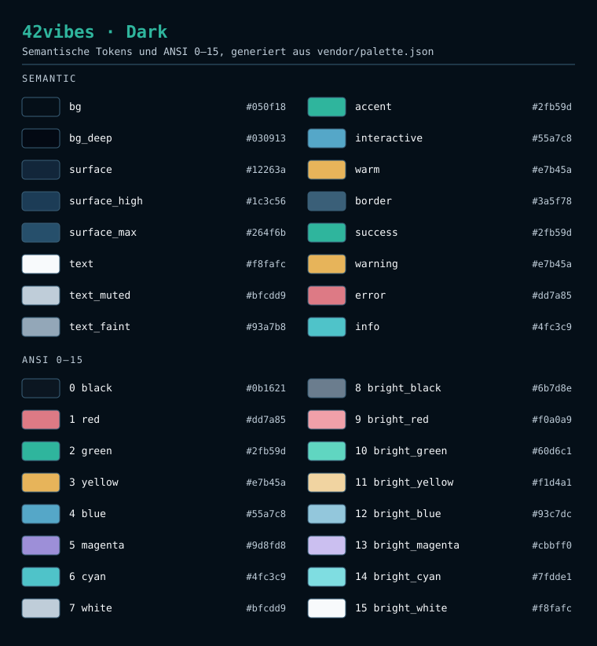
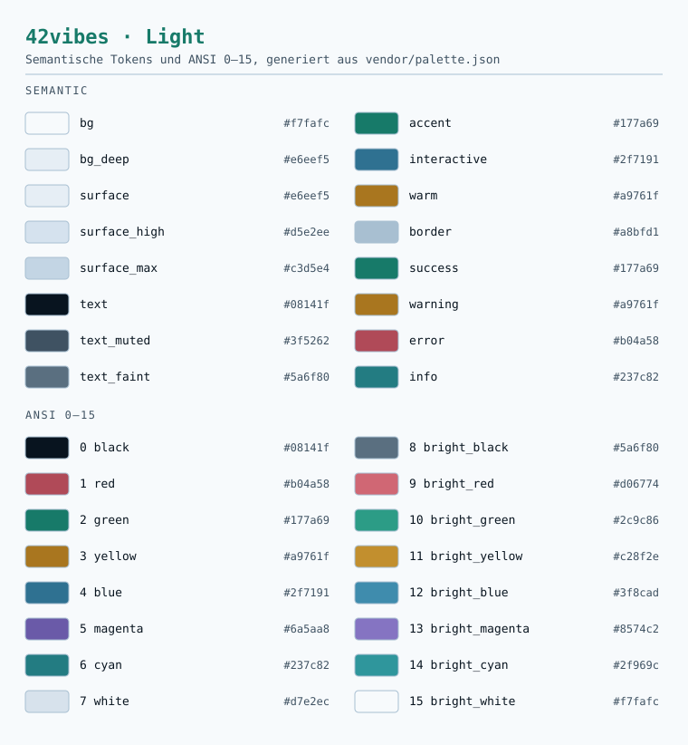

# 42vibes – Shell- und Tool-Profile

[English](README.md) · **Deutsch**

Ein eigenständiges Profil-Set für Starship, `ls`/dircolors, bat und delta,
abgeleitet aus der 42vibes-Palette (`vendor/palette.json`). Alles ist als
Kopiervorlage gedacht: dieses Repo installiert nichts global und ändert keine
Nutzer-Configs.

## Reihenfolge: Terminal-Profil zuerst

Die Farben wirken nur zusammen, wenn das Terminal-Profil die Basis setzt.
Empfohlene Reihenfolge:

1. **Terminal-Profil** (Hintergrund, Vordergrund, Cursor, Auswahl, ANSI 16)
2. **Starship** (`starship.toml`)
3. **bat** (`bat/42vibes.tmTheme`, `bat/42vibes-light.tmTheme`)
4. **delta** (`delta.gitconfig`)
5. **ls-Farben** (`dircolors.gnu` für GNU ls, `lscolors.bsd` für macOS `/bin/ls`)
6. **`palette.sh`** in eigenen Skripten

Warum zuerst das Terminal? Starship und bat sprechen Hex/Truecolor, `ls` und
delta sprechen ANSI-Namen. Wenn die ANSI-Slots im Terminal nicht zur Palette
passen, sehen dieselben Rollen in den Werkzeugen unterschiedlich aus.

## Palette

Die folgende Vorschau ist generiert: `build.py` erzeugt beide SVGs aus
`vendor/palette.json`. Es sind keine Screenshots; bitte nicht von Hand
bearbeiten.

**Dark**



**Light**



Semantische Tokens (Dark/Light):

| Rolle | Variable | Dark | Light |
| --- | --- | --- | --- |
| bg | `VIBES_BG` | `#050f18` | `#f7fafc` |
| bg_deep | `VIBES_BG_DEEP` | `#030913` | `#e6eef5` |
| surface | `VIBES_SURFACE` | `#12263a` | `#e6eef5` |
| surface_high | `VIBES_SURFACE_HIGH` | `#1c3c56` | `#d5e2ee` |
| surface_max | `VIBES_SURFACE_MAX` | `#264f6b` | `#c3d5e4` |
| text | `VIBES_TEXT` | `#f8fafc` | `#08141f` |
| text_muted | `VIBES_TEXT_MUTED` | `#bfcdd9` | `#3f5262` |
| text_faint | `VIBES_TEXT_FAINT` | `#93a7b8` | `#5a6f80` |
| accent | `VIBES_ACCENT` | `#2fb59d` | `#177a69` |
| interactive | `VIBES_INTERACTIVE` | `#55a7c8` | `#2f7191` |
| warm | `VIBES_WARM` | `#e7b45a` | `#a9761f` |
| border | `VIBES_BORDER` | `#3a5f78` | `#a8bfd1` |
| success | `VIBES_SUCCESS` | `#2fb59d` | `#177a69` |
| warning | `VIBES_WARNING` | `#e7b45a` | `#a9761f` |
| error | `VIBES_ERROR` | `#dd7a85` | `#b04a58` |
| info | `VIBES_INFO` | `#4fc3c9` | `#237c82` |

Die Hue-Ramps entstehen in HSL: nur die Helligkeit wandert, Farbton und
Sättigung bleiben erhalten. Die Stufen sind identisch zu den anderen
42vibes-Zielen (Dark `+0.28 … -0.38`, Light `-0.30 … +0.28`, Sättigung ×0.55
bei 100/900).

### ANSI-Reihenfolge

| Name | Dark | Light | SGR |
| --- | --- | --- | --- |
| black | `#0b1621` | `#08141f` | 30 |
| red | `#dd7a85` | `#b04a58` | 31 |
| green | `#2fb59d` | `#177a69` | 32 |
| yellow | `#e7b45a` | `#a9761f` | 33 |
| blue | `#55a7c8` | `#2f7191` | 34 |
| magenta | `#9d8fd8` | `#6a5aa8` | 35 |
| cyan | `#4fc3c9` | `#237c82` | 36 |
| white | `#bfcdd9` | `#d7e2ec` | 37 |
| bright_black | `#6b7d8e` | `#5a6f80` | 90 |
| bright_red | `#f0a0a9` | `#d06774` | 91 |
| bright_green | `#60d6c1` | `#2c9c86` | 92 |
| bright_yellow | `#f1d4a1` | `#c28f2e` | 93 |
| bright_blue | `#93c7dc` | `#3f8cad` | 94 |
| bright_magenta | `#cbbff0` | `#8574c2` | 95 |
| bright_cyan | `#7fdde1` | `#2f969c` | 96 |
| bright_white | `#f8fafc` | `#f7fafc` | 97 |

Diese 16 Werte gehören ins Terminal-Profil. `dircolors.gnu` und
`lscolors.bsd` verwenden genau diese Slots; sie können kein Hex ausgeben.

## Starship

`starship.toml` enthält zwei Paletten: `[palettes.42vibes]` (Dark, Default)
und `[palettes.42vibes_light]`. Die aktive Palette steht oben als
`palette = "42vibes"`; für hellen Hintergrund auf `42vibes_light` ändern.

Einbinden, ohne globale Config zu überschreiben:

```sh
export STARSHIP_CONFIG="$PWD/starship.toml"
# oder: cp starship.toml ~/.config/starship.toml
```

Prompt-Stil (zwei Zeilen statt drei):

- Status **fett/rot**, nur bei Exit-Code != 0 (`status`, leerer
  `success_symbol`); die erste Zeile beginnt mit `╭─`, das Character-Symbol
  wechselt auf das rote Fehlerzeichen.
- User/Host **gedämpft** und nur wenn relevant (`username.show_always =
  false`, `hostname.ssh_only = true`). Beide Formate enden ohne Leerzeichen;
  die Gruppe `($username$hostname )` liefert das Trennleerzeichen.
- Verzeichnis **fett** in Blau (`directory` → `bold interactive`).
- Git-Branch **fett** in Petrol (`git_branch` → `bold accent`); `git_status`
  zeigt nur geänderte und konfliktbehaftete Einträge (`untracked`, `ahead`,
  `behind` und `diverged` sind leer, `ignore_submodules = true`).
- Kontexte statt Versionen: `kubernetes` in Blau (`k8s <Kontext>/<Namespace>`),
  aber nur, wenn das aktuelle Verzeichnis oder die Umgebung tatsächlich auf
  Kubernetes zeigt (siehe unten); `terraform` in Petrol (`tf <Workspace>`),
  `aws` in Gold (`aws <Profil>`); `git_state`, `cmd_duration` und `jobs`
  bleiben kontextuell.
- Die Uhrzeit steht in der zweiten Zeile: `time` in gedämpftem Grau, direkt vor
  `$line_break`, im 24-Stunden-Format (siehe unten).
- Kürzung: `truncation_symbol = "…/"` ist reiner Text, kein Format-String,
  und erbt den Verzeichnis-Stil; der aktuelle Ordnername bleibt fett.
- `$line_break` beginnt die zweite Zeile, `╰─` und das Character-Symbol
  schließen sie ab. Sprachversionen (`python`, `nodejs`, `deno`, `bun`,
  `rust`, `golang`, `java`, `kotlin`, `ruby`, `php`, `elixir`, `haskell`,
  `lua`, `perl`, `swift`, `zig`, `dotnet`), `package`, `shell` und
  `docker_context` sind bewusst entfernt, damit der Prompt kurz bleibt.

### Uhrzeit

Der Prompt bleibt zweizeilig. `$time` steht am Ende der Kontextzeile, direkt
vor `$line_break`. Die `[time]`-Tabelle nutzt `style = "muted"` und
`format = "[$time]($style) "`, die Uhrzeit erscheint also im selben gedämpften
Grau wie der Rahmen. Das Modul ist explizit aktiviert (`disabled = false`;
Starship liefert es deaktiviert aus), und Starship nutzt standardmäßig das
24-Stunden-Format `%R` (`14:05`).

### Returncode

`status` bleibt im globalen Format und schweigt im Erfolgsfall bewusst:
`success_symbol = ""`, damit Exit-Code 0 nichts hinzufügt (kein `0`-Rauschen).
Bei Exit-Code != 0 erscheinen Symbol **und** numerischer Code, zum Beispiel
`✖ 127`; zusätzlich wechselt das Character-Symbol auf das rote Fehlerzeichen.
Das Modulformat ist `[$symbol $status]($style) ` – dadurch wird der Code
sichtbar.

### Kubernetes-Erkennung

`kubernetes` erscheint nur, wenn tatsächlich mit Kubernetes gearbeitet wird.
Starship verknüpft die Erkennungsbedingungen mit ODER: eine Datei aus
`detect_files` (`kustomization.yaml`, `kustomization.yml`, `Chart.yaml`,
`kind-config.yaml`, `kind.yaml`, `k8s.yaml`), ein Ordner aus `detect_folders`
(`k8s`, `kubernetes`, `manifests`, `helm`, `.kube`) oder die
Umgebungsvariable `KUBECONFIG`. Passt eine Bedingung und ist eine Kubeconfig
lesbar, zeigt das Modul `k8s <Kontext>/<Namespace>`.

Ohne `KUBECONFIG` und ohne `~/.kube/config` rendert das Modul nichts, selbst
wenn ein Marker passt. Existiert eine Kubeconfig, hat der aktuelle Ordner aber
keine Kubernetes-Marker und ist `KUBECONFIG` nicht gesetzt, bleibt das Modul
ebenfalls unsichtbar. `disabled = false` hält das Modul verfügbar; allein die
Erkennung entscheidet über die Sichtbarkeit.

Performance: `command_timeout = 1000` (1 s pro externem Befehl) verhindert,
dass ein langsamer Befehl den Prompt lange blockiert; `scan_timeout = 30` (ms)
begrenzt den Verzeichnis-Scan. In sehr großen Repositories `git_status` bei
Bedarf deaktivieren (`[git_status] disabled = true`).

**Keine Nerd-Font-Pflicht:** Das Profil nutzt nur normale Unicode-Zeichen
(`❯`, `╭`, `╰`, `…`) und Textlabels wie `k8s`, `tf`, `aws`. Wer Nerd-Font-
Symbole möchte, kann die `format`-Zeilen der Module selbst ergänzen.

## Dateifarben: GNU ls vs. macOS ls

Das sind zwei verschiedene Mechanismen – nicht verwechseln:

| | GNU ls (Linux, coreutils) | macOS `/bin/ls` (BSD) |
| --- | --- | --- |
| Variable | `LS_COLORS` | `LSCOLORS` (+ `CLICOLOR=1`) |
| Generator | `dircolors` | keiner |
| Datei hier | `dircolors.gnu` | `lscolors.bsd` |
| Umfang | 16 ANSI-Farben + beliebig viele Endungen | 11 Attributpaare, 8 Farben |
| Hex/Truecolor | nein (SGR) | nein |

### GNU ls: `dircolors.gnu`

```sh
eval "$(dircolors /pfad/zu/dircolors.gnu)"
```

Die Datei ist ein vollständiges GNU-`LS_COLORS`-Set: Standardtypen,
SUID/SGID/Sticky, Archive, Audio, Bilder, Video, Dokumente, Quellcode,
Web/Konfiguration, Build-Artefakte und Sicherungen. Diff-Dateien sind bewusst
eigene Rollen: `.diff` fett gelb, `.patch` fett cyan, `.rej` fett rot,
`.orig` gedämpft. So bleiben sie neben Grün/Rot für hinzugefügte und entfernte
Zeilen unterscheidbar.

`LEFTCODE`, `RIGHTCODE`, `ENDCODE` und `CLRTOEOL` enthalten **keine**
SGR-Zahlen, sondern Steuersequenzen (`\e[`, `m`, `\e[0m`, `\e[K`), die `ls`
wörtlich um den SGR-Wert eines Eintrags schreibt. Alle anderen Werte sind
reine SGR-Sequenzen wie `01;34`. SGR-Zahlen an diesen vier Stellen landen als
Text in der Ausgabe, z.B. `0001;3401;34name00`.

Prüfen: `dircolors -b dircolors.gnu` (Exit 0).

### macOS `/bin/ls`: `lscolors.bsd`

```sh
. /pfad/zu/lscolors.bsd
```

Das Skript setzt `CLICOLOR=1` und `LSCOLORS`. **Wichtig:** macOS `ls(1)`
dokumentiert **11 Paare** – Verzeichnis, Symlink, Socket, Pipe, Executable,
Blockgerät, Zeichengerät, setuid, setgid, sticky+writable, writable. Ein
8-Paare-Wert (16 Zeichen) wird von `/bin/ls` abgelehnt; `lscolors.bsd` nutzt
daher korrekt 11 Paare (22 Zeichen).

`/bin/ls` ignoriert `LS_COLORS` vollständig. Wer auf macOS GNU ls nutzt
(Homebrew `coreutils`, Befehle `gls` und `gdircolors`), verwendet stattdessen
`dircolors.gnu`:

```sh
eval "$(gdircolors /pfad/zu/dircolors.gnu)"
alias ls='gls --color=auto'
```

## bat

```sh
mkdir -p "$(bat --config-dir)/themes"
cp bat/42vibes.tmTheme bat/42vibes-light.tmTheme "$(bat --config-dir)/themes/"
bat cache --build
export BAT_THEME=42vibes          # dunkler Hintergrund
# export BAT_THEME=42vibes-light  # heller Hintergrund
bat --list-themes | grep 42vibes
```

`bat --theme` erwartet einen Theme-**Namen**, den bat aus seinem Cache kennt,
keinen Dateipfad. Die Schritte oben (kopieren und `bat cache --build`) sind
daher erforderlich; danach funktioniert `bat --theme=42vibes datei` (oder
`BAT_THEME`).

Beide Themes sind valide tmThemes (XML/plist) mit denselben Scopes: Kommentar,
Keyword, String, Zahl, Konstante, Funktion, Typ, Variable, Operator, Markup
(heading/strong/link/quote) und `invalid`. `42vibes` nutzt die Dark-Ramps,
`42vibes-light` dieselben Ramps und Scopes auf Basis der Light-Werte.
Kommentare und Zitate sind kursiv, Überschriften und Strong fett, Links
unterstrichen. `validate.py` prüft für beide Dateien die Pflicht-Scopes und
sinnvolle Kontraste (Text/Syntax ≥ 4,5:1, Hilfsfarben ≥ 3:1).

## delta

`delta.gitconfig` ist ein Snippet, keine globale Änderung. Einbinden:

```gitconfig
[include]
    path = /pfad/zu/delta.gitconfig
```

oder pro Aufruf `git -c include.path=/pfad/zu/delta.gitconfig diff`.

Das Snippet setzt `[core] pager = delta`, `[interactive] diffFilter` und zwei
Features: `[delta "42vibes"]` (Dark, Default) und `[delta "42vibes-light"]`
(Light). Farbrollen: Blau für Datei/Pfad, Gelb/Gold für Hunk und Commit, Rot
für entfernte Zeilen und Zeilennummern, Grün für hinzugefügte Zeilen, Cyan für
neutrale Zeilennummern.

Das Light-Feature nach dem Einbinden aktivieren. Den `[include]` vor einer
eventuellen `[delta]`-Sektion platzieren, damit `features = 42vibes` aus dem
Snippet nicht gewinnt:

```sh
git config --global include.path /pfad/zu/delta.gitconfig
git config --global delta.features 42vibes-light   # hell
git config --global delta.features 42vibes          # zurück zu dunkel
```

Für einen einzelnen Aufruf: `git -c delta.features=42vibes-light diff`.

**Grenzen von Light:** `42vibes-light` nutzt ANSI-Namen, kein Hex. Die
konkreten Farben kommen daher aus den ANSI-Slots 0–15 des Terminal-Profils;
das helle Terminal-Profil verwenden. `[delta] syntax-theme = 42vibes` ist eine
Top-Level-Option, und delta bevorzugt `[delta]` gegenüber Features; das
Light-Feature kann das Syntax-Theme deshalb nicht umschalten. Für helle
Syntax-Hervorhebung `git -c delta.syntax-theme=42vibes-light diff` verwenden;
das bat-Theme muss über `bat cache --build` bekannt sein.

**Hex-Hinweis:** delta akzeptiert in neueren Versionen `#rrggbb` in
Style-Werten, ältere Versionen und Terminals ohne Truecolor aber nicht
zuverlässig. Das Snippet nutzt deshalb für beide Features ANSI-Namen. Die
passenden Hex-Werte stehen in der Palette-Tabelle; zum Testen `delta
--version` und `git diff` verwenden.

## palette.sh

POSIX-sh-kompatibel und für macOS bash 3.2 geeignet: keine Arrays, keine
Assoziativ-Arrays, keine bash-4-Features.

```sh
. /pfad/zu/palette.sh
printf '%s\n' "$C_ACCENT" "$VIBES_BG" "$VIBES_ANSI_RED"
```

Exportiert werden:

- `VIBES_*` für Dark (Default) und `VIBES_LIGHT_*` für Light,
- `VIBES_ANSI_*` bzw. `VIBES_LIGHT_ANSI_*` für die 16 ANSI-Slots,
- kurze `C_*`-Variablen (Dark): `C_BG`, `C_TEXT`, `C_MUTED`, `C_ACCENT`,
  `C_BLUE`, `C_GOLD`, `C_ERROR`, `C_RED`, `C_GREEN`, `C_YELLOW`, …

Die Datei wird **gesourct**, nicht ausgeführt – sonst verschwinden die
Exporte mit der Subshell. Wer Escape-Sequenzen braucht, baut sie aus den
Hex-Werten selbst; `palette.sh` liefert nur Farbwerte.

## macOS-Unterschiede

- **`/bin/ls` vs. GNU ls:** macOS `/bin/ls` liest `LSCOLORS` (`lscolors.bsd`),
  GNU ls liest `LS_COLORS` (`dircolors.gnu`). `dircolors` gibt es auf macOS
  nicht; Homebrew-coreutils bringt `gdircolors` und `gls` mit.
- **bash 3.2:** `palette.sh` vermeidet Arrays und bash-4-Syntax. `source`
  funktioniert, `.` ist POSIX und ebenfalls ok.
- **Terminal.app:** kein Truecolor. Hex-Farben aus Starship/bat werden auf
  256/16 Farben abgebildet; ANSI-basierte Werkzeuge (`ls`, delta) bleiben
  exakt. Für exakte Hex-Werte iTerm2, Kitty, WezTerm oder Ghostty mit
  `COLORTERM=truecolor` verwenden.

## Fett und Truecolor

- Starship: `bold` ist ein Style-Token (`bold interactive`). Manche Terminals
  stellen „fett“ als helle Farbe statt als Schriftgewicht dar.
- bat: `fontStyle` `bold`/`italic`/`underline`; wenn die Schrift das nicht
  kann, bleibt der Text farbig, aber ohne Schnitt.
- Wenn ein Terminal kein Fett rendert, `bold` aus den Styles entfernen – die
  Rollen bleiben über Farbe und Position erkennbar.
- Truecolor: `COLORTERM=truecolor` prüfen (`printf '%s\n' "$COLORTERM"`).
  Ohne Truecolor werden Hex-Werte approximiert.

## Farbzuordnung Starship/bat

| Rolle | Palette | Starship | bat-Scope |
| --- | --- | --- | --- |
| Verzeichnis (fett) | `interactive` #55a7c8 | `directory` → `bold interactive` | – |
| Git-Branch (fett) | `accent` #2fb59d | `git_branch` → `bold accent` | – |
| Fehler (fett/rot) | `error` #dd7a85 | `character`/`status` → `bold error` | `invalid` |
| User/Host (gedämpft) | `muted` #bfcdd9 | `username`/`hostname` → `muted` | – |
| Kontext (k8s/tf/aws) | petrol/blue/gold | `kubernetes`/`terraform`/`aws` | – |
| Kommentar | `gray.400` #b3bfca | – | `comment` (italic) |
| Keyword | `purple.300` #bbb1e4 | – | `keyword`, `storage` |
| String | `green.300` #44ceb5 | – | `string` |
| Zahl | `orange.300` #edc682 | – | `constant.numeric` |
| Konstante | `yellow.300` #f5e0b3 | – | `constant` |
| Funktion | `blue.300` #78b9d3 | – | `function` |
| Typ | `cyan.300` #72cfd4 | – | `type` |
| Variable | `gray.200` #d7dee3 | – | `variable` |
| Überschrift | `green.300` #44ceb5 | – | `markup.heading` (bold) |
| Link | `blue.300` #78b9d3 | – | `markup.link` (underline) |
| Invalid | `red.200`/`red.900` | – | `invalid` |
| Diff plus/minus | ansi green/red | – | `markup.inserted`/`markup.deleted` |

Die Tabelle zeigt die Dark-Werte. `42vibes-light.tmTheme` verwendet dieselben
Scopes mit den Light-Rampen; `validate.py` prüft die Kontraste für beide
Themes.

## Bauen und prüfen

```sh
python3 build.py          # erzeugt alle generierten Dateien neu
python3 build.py --check  # prüft, ob die eingecheckten Dateien aktuell sind
python3 validate.py       # TOML, XML, sh -n, dircolors, git config, LSCOLORS
make check                # beides
```

`build.py` ist die Quelle der Wahrheit. Farben ändern: `vendor/palette.json`
aus `../42vibes-palette` aktualisieren, dann `make build validate`.
`README.md`, `README.de.md`, `starship.toml`, `dircolors.gnu`, `lscolors.bsd`,
`bat/42vibes.tmTheme`, `bat/42vibes-light.tmTheme`, `delta.gitconfig`,
`palette.sh`, `preview/palette-dark.svg` und `preview/palette-light.svg` sind
generiert und eingecheckt.

## Struktur

```text
.
├── build.py                 # Generator (Palette -> alle Artefakte)
├── validate.py              # strukturelle und syntaktische Prüfungen
├── Makefile                 # build / validate / check
├── vendor/palette.json      # Kopie der gemeinsamen Palette
├── starship.toml            # generiert
├── dircolors.gnu            # generiert (GNU ls)
├── lscolors.bsd             # generiert (macOS /bin/ls)
├── bat/42vibes.tmTheme     # generiert (bat, Dark)
├── bat/42vibes-light.tmTheme  # generiert (bat, Light)
├── delta.gitconfig          # generiert (git/delta)
├── palette.sh               # generiert (POSIX sh)
└── preview/
    ├── palette-dark.svg     # generiert (Palettenvorschau)
    └── palette-light.svg    # generiert (Palettenvorschau)
```

## Offene Punkte

- **delta und Hex:** Das Snippet verwendet ANSI-Namen. Hex ist in neuen
  delta-Versionen möglich, aber nicht in allen Umgebungen sicher; bei Bedarf
  die Hex-Werte aus der Palette-Tabelle einsetzen und testen.
- **LSCOLORS-Paare:** Vorgabe war 8 Paare, macOS `ls(1)` verlangt 11.
  Die Datei folgt der macOS-Dokumentation; 8 Paare wären ungültig.
- **Light-Varianten:** Starship und bat haben Light-Varianten
  (`42vibes_light`, `42vibes-light.tmTheme`); delta hat das Feature
  `42vibes-light`, nutzt aber ANSI-Namen und behält ohne Override das dunkle
  Syntax-Theme (siehe delta). `dircolors.gnu` und `lscolors.bsd` sind auf den
  dunklen Hintergrund abgestimmt. Die Light-Werte stehen in der
  Palette-Tabelle für eigene Ableitungen.
- **Terminal.app:** kein Truecolor; Hex-Farben werden approximiert.
- **Nerd Font:** absichtlich keine Private-Use-Glyphen; Symbole sind optional.
- **delta `syntax-theme`:** setzt voraus, dass das bat-Theme installiert und
  mit `bat cache --build` bekannt ist.

## Lizenz

MIT, Copyright 2026 42vibes. Der vollständige Text steht in [`LICENSE`](LICENSE).
