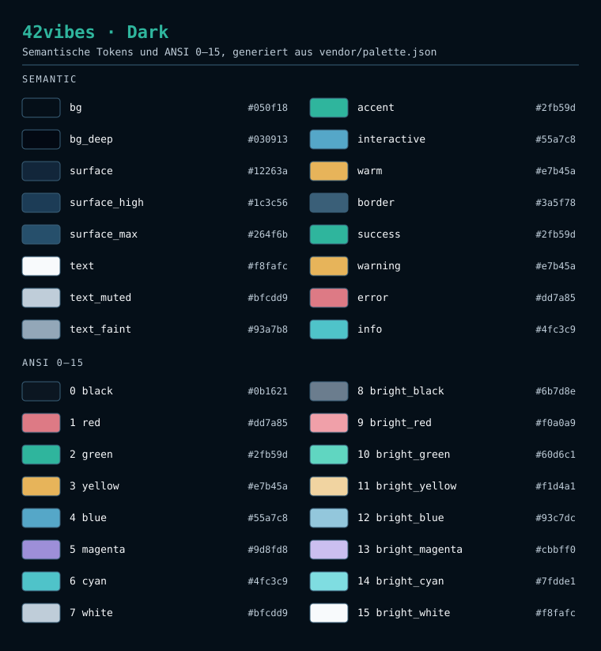
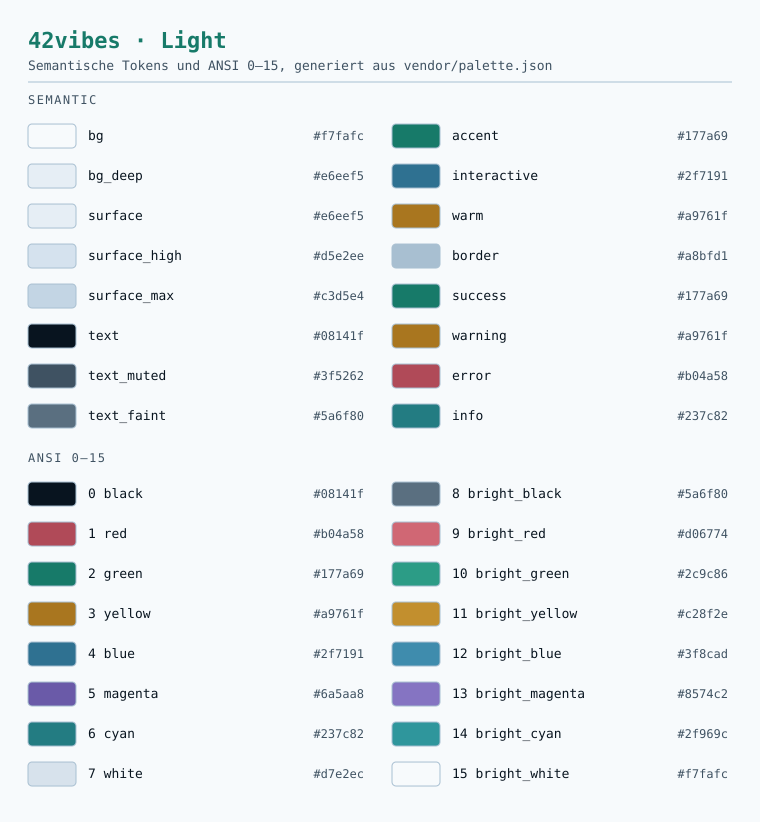

# 42vibes – Shell and tool profiles

**English** · [Deutsch](README.de.md)

A standalone profile set for Starship, `ls`/dircolors, bat and delta, derived
from the 42vibes palette (`vendor/palette.json`). Everything is meant as a
copy template: this repo installs nothing globally and does not change any
user config.

## Order: terminal profile first

The colors only work together if the terminal profile sets the base.
Recommended order:

1. **Terminal profile** (background, foreground, cursor, selection, ANSI 16)
2. **Starship** (`starship.toml`)
3. **bat** (`bat/42vibes.tmTheme`, `bat/42vibes-light.tmTheme`)
4. **delta** (`delta.gitconfig`)
5. **ls colors** (`dircolors.gnu` for GNU ls, `lscolors.bsd` for macOS `/bin/ls`)
6. **`palette.sh`** in your own scripts

Why the terminal first? Starship and bat speak hex/truecolor, `ls` and delta
speak ANSI names. If the ANSI slots in the terminal do not match the palette,
the same roles look different in the tools.

## Palette

The preview below is generated: `build.py` creates both SVGs from
`vendor/palette.json`. These are not screenshots; please do not edit them by
hand.

**Dark**



**Light**



Semantic tokens (dark/light):

| Role | Variable | Dark | Light |
| --- | --- | --- | --- |
| bg | `VIBES_BG` | `#050f18` | `#f7fafc` |
| bg_deep | `VIBES_BG_DEEP` | `#030913` | `#e6eef5` |
| surface | `VIBES_SURFACE` | `#12263a` | `#e6eef5` |
| surface_high | `VIBES_SURFACE_HIGH` | `#1c3c56` | `#d5e2ee` |
| surface_max | `VIBES_SURFACE_MAX` | `#264f6b` | `#c3d5e4` |
| text | `VIBES_TEXT` | `#f8fafc` | `#08141f` |
| text_muted | `VIBES_TEXT_MUTED` | `#bfcdd9` | `#3f5262` |
| text_faint | `VIBES_TEXT_FAINT` | `#93a7b8` | `#5a6f80` |
| accent | `VIBES_ACCENT` | `#2fb59d` | `#177a69` |
| interactive | `VIBES_INTERACTIVE` | `#55a7c8` | `#2f7191` |
| warm | `VIBES_WARM` | `#e7b45a` | `#a9761f` |
| border | `VIBES_BORDER` | `#3a5f78` | `#a8bfd1` |
| success | `VIBES_SUCCESS` | `#2fb59d` | `#177a69` |
| warning | `VIBES_WARNING` | `#e7b45a` | `#a9761f` |
| error | `VIBES_ERROR` | `#dd7a85` | `#b04a58` |
| info | `VIBES_INFO` | `#4fc3c9` | `#237c82` |

The hue ramps are built in HSL: only lightness moves, hue and saturation stay
the same. The steps are identical to the other 42vibes targets (dark
`+0.28 … -0.38`, light `-0.30 … +0.28`, saturation ×0.55 at 100/900).

### ANSI order

| Name | Dark | Light | SGR |
| --- | --- | --- | --- |
| black | `#0b1621` | `#08141f` | 30 |
| red | `#dd7a85` | `#b04a58` | 31 |
| green | `#2fb59d` | `#177a69` | 32 |
| yellow | `#e7b45a` | `#a9761f` | 33 |
| blue | `#55a7c8` | `#2f7191` | 34 |
| magenta | `#9d8fd8` | `#6a5aa8` | 35 |
| cyan | `#4fc3c9` | `#237c82` | 36 |
| white | `#bfcdd9` | `#d7e2ec` | 37 |
| bright_black | `#6b7d8e` | `#5a6f80` | 90 |
| bright_red | `#f0a0a9` | `#d06774` | 91 |
| bright_green | `#60d6c1` | `#2c9c86` | 92 |
| bright_yellow | `#f1d4a1` | `#c28f2e` | 93 |
| bright_blue | `#93c7dc` | `#3f8cad` | 94 |
| bright_magenta | `#cbbff0` | `#8574c2` | 95 |
| bright_cyan | `#7fdde1` | `#2f969c` | 96 |
| bright_white | `#f8fafc` | `#f7fafc` | 97 |

These 16 values belong in the terminal profile. `dircolors.gnu` and
`lscolors.bsd` use exactly these slots; they cannot output hex.

## Starship

`starship.toml` contains two palettes: `[palettes.42vibes]` (dark, default)
and `[palettes.42vibes_light]`. The active palette is set at the top as
`palette = "42vibes"`; change it to `42vibes_light` for a light background.

Include it without overwriting the global config:

```sh
export STARSHIP_CONFIG="$PWD/starship.toml"
# or: cp starship.toml ~/.config/starship.toml
```

Prompt style (two lines instead of three):

- Status **bold/red**, only on a non-zero exit code (`status`, empty
  `success_symbol`); the `╭─` marker starts the first line, the character
  switches to the red error symbol.
- User/host **muted** and only shown when relevant (`username.show_always =
  false`, `hostname.ssh_only = true`). Both formats end without a space; the
  group `($username$hostname )` supplies the separating space.
- Directory **bold** in blue (`directory` → `bold interactive`).
- Git branch **bold** in petrol (`git_branch` → `bold accent`); `git_status`
  only shows changed and conflicted entries (`untracked`, `ahead`, `behind`
  and `diverged` are empty, `ignore_submodules = true`).
- Contexts instead of versions: `kubernetes` in blue (`k8s <context>/<namespace>`),
  `terraform` in petrol (`tf <workspace>`), `aws` in gold (`aws <profile>`);
  `git_state`, `cmd_duration` and `jobs` stay contextual.
- Truncation: `truncation_symbol = "…/"` is plain text, not a format string,
  and inherits the directory style; the current directory name stays bold.
- `$line_break` starts the second line, `╰─` and the character close it.
  Language version modules (`python`, `nodejs`, `deno`, `bun`, `rust`,
  `golang`, `java`, `kotlin`, `ruby`, `php`, `elixir`, `haskell`, `lua`,
  `perl`, `swift`, `zig`, `dotnet`), `package`, `shell`, `time` and
  `docker_context` are deliberately removed to keep the prompt short.

Performance: `command_timeout = 1000` (1 s per external command) keeps a slow
command from blocking the prompt for long, `scan_timeout = 30` (ms) limits the
directory scan. In very large repositories, disable `git_status` on demand
(`[git_status] disabled = true`).

**No Nerd Font requirement:** the profile only uses regular Unicode characters
(`❯`, `╭`, `╰`, `…`) and text labels such as `k8s`, `tf`, `aws`. If you want
Nerd Font symbols, you can add them to the `format` lines of the modules.

## File colors: GNU ls vs. macOS ls

These are two different mechanisms – do not mix them up:

| | GNU ls (Linux, coreutils) | macOS `/bin/ls` (BSD) |
| --- | --- | --- |
| Variable | `LS_COLORS` | `LSCOLORS` (+ `CLICOLOR=1`) |
| Generator | `dircolors` | none |
| File here | `dircolors.gnu` | `lscolors.bsd` |
| Scope | 16 ANSI colors + any number of extensions | 11 attribute pairs, 8 colors |
| Hex/truecolor | no (SGR) | no |

### GNU ls: `dircolors.gnu`

```sh
eval "$(dircolors /path/to/dircolors.gnu)"
```

The file is a complete GNU `LS_COLORS` set: standard types, SUID/SGID/sticky,
archives, audio, images, video, documents, source code, web/configuration,
build artifacts and backups. Diff files are deliberately separate roles:
`.diff` bold yellow, `.patch` bold cyan, `.rej` bold red, `.orig` muted. That
keeps them distinguishable from green/red for added and removed lines.

`LEFTCODE`, `RIGHTCODE`, `ENDCODE` and `CLRTOEOL` do **not** hold SGR numbers:
they are control sequences (`\e[`, `m`, `\e[0m`, `\e[K`) that `ls` writes
verbatim around the SGR value of an entry. Every other value is a plain SGR
sequence such as `01;34`. SGR numbers in those four slots would end up as
literal text, e.g. `0001;3401;34name00`.

Check: `dircolors -b dircolors.gnu` (exit 0).

### macOS `/bin/ls`: `lscolors.bsd`

```sh
. /path/to/lscolors.bsd
```

The script sets `CLICOLOR=1` and `LSCOLORS`. **Important:** macOS `ls(1)`
documents **11 pairs** – directory, symlink, socket, pipe, executable, block
device, character device, setuid, setgid, sticky+writable, writable. An
8-pair value (16 characters) is rejected by `/bin/ls`; `lscolors.bsd`
therefore correctly uses 11 pairs (22 characters).

`/bin/ls` ignores `LS_COLORS` completely. If you use GNU ls on macOS
(Homebrew `coreutils`, commands `gls` and `gdircolors`), use `dircolors.gnu`
instead:

```sh
eval "$(gdircolors /path/to/dircolors.gnu)"
alias ls='gls --color=auto'
```

## bat

```sh
mkdir -p "$(bat --config-dir)/themes"
cp bat/42vibes.tmTheme bat/42vibes-light.tmTheme "$(bat --config-dir)/themes/"
bat cache --build
export BAT_THEME=42vibes          # dark background
# export BAT_THEME=42vibes-light  # light background
bat --list-themes | grep 42vibes
```

`bat --theme` takes a theme *name* that bat knows from its cache, not a file
path. The copy and `bat cache --build` steps above are therefore required;
after that, `bat --theme=42vibes file` works (or use `BAT_THEME`).

Both themes are valid tmThemes (XML/plist) with the same scopes: comment,
keyword, string, number, constant, function, type, variable, operator, markup
(heading/strong/link/quote) and `invalid`. `42vibes` uses the dark ramps,
`42vibes-light` the same ramps and scopes based on the light values.
Comments and quotes are italic, headings and strong bold, links underlined.
`validate.py` checks the required scopes and sensible contrasts for both files
(text/syntax ≥ 4.5:1, auxiliary colors ≥ 3:1).

## delta

`delta.gitconfig` is a snippet, not a global change. Include it:

```gitconfig
[include]
    path = /path/to/delta.gitconfig
```

or per invocation `git -c include.path=/path/to/delta.gitconfig diff`.

The snippet sets `[core] pager = delta`, `[interactive] diffFilter` and two
features: `[delta "42vibes"]` (dark, default) and
`[delta "42vibes-light"]` (light). Color roles: blue for file/path,
yellow/gold for hunk and commit, red for removed lines and line numbers,
green for added lines, cyan for neutral line numbers.

Activate the light feature after including the snippet. Place the `[include]`
before any `[delta]` section so the snippet's `features = 42vibes` does not
win:

```sh
git config --global include.path /path/to/delta.gitconfig
git config --global delta.features 42vibes-light   # light
git config --global delta.features 42vibes          # back to dark
```

For a single invocation use `git -c delta.features=42vibes-light diff`.

**Light limits:** `42vibes-light` uses ANSI names, not hex. Its actual colors
therefore come from ANSI slots 0–15 of the terminal profile; use the light
terminal profile. The snippet's `[delta] syntax-theme = 42vibes` is a
top-level option, and delta gives `[delta]` precedence over features, so the
light feature cannot switch the syntax theme. For light syntax highlighting
use `git -c delta.syntax-theme=42vibes-light diff`; the bat theme must be
known via `bat cache --build`.

**Hex note:** delta accepts `#rrggbb` in style values in newer versions, but
not reliably in older versions and terminals without truecolor. The snippet
therefore uses ANSI names for both features. The matching hex values are in
the palette table; to test, use `delta --version` and `git diff`.

## palette.sh

POSIX sh compatible and suitable for macOS bash 3.2: no arrays, no associative
arrays, no bash 4 features.

```sh
. /path/to/palette.sh
printf '%s\n' "$C_ACCENT" "$VIBES_BG" "$VIBES_ANSI_RED"
```

Exported are:

- `VIBES_*` for dark (default) and `VIBES_LIGHT_*` for light,
- `VIBES_ANSI_*` and `VIBES_LIGHT_ANSI_*` for the 16 ANSI slots,
- short `C_*` variables (dark): `C_BG`, `C_TEXT`, `C_MUTED`, `C_ACCENT`,
  `C_BLUE`, `C_GOLD`, `C_ERROR`, `C_RED`, `C_GREEN`, `C_YELLOW`, …

The file is **sourced**, not executed – otherwise the exports disappear with
the subshell. If you need escape sequences, build them from the hex values
yourself; `palette.sh` only provides color values.

## macOS differences

- **`/bin/ls` vs. GNU ls:** macOS `/bin/ls` reads `LSCOLORS` (`lscolors.bsd`),
  GNU ls reads `LS_COLORS` (`dircolors.gnu`). `dircolors` does not exist on
  macOS; Homebrew coreutils provides `gdircolors` and `gls`.
- **bash 3.2:** `palette.sh` avoids arrays and bash 4 syntax. `source` works,
  `.` is POSIX and also fine.
- **Terminal.app:** no truecolor. Hex colors from Starship/bat are mapped to
  256/16 colors; ANSI-based tools (`ls`, delta) stay exact. For exact hex
  values use iTerm2, Kitty, WezTerm or Ghostty with `COLORTERM=truecolor`.

## Bold and truecolor

- Starship: `bold` is a style token (`bold interactive`). Some terminals
  render “bold” as a bright color rather than as a font weight.
- bat: `fontStyle` `bold`/`italic`/`underline`; if the font cannot do that,
  the text stays colored but without the face.
- If a terminal does not render bold, remove `bold` from the styles – the
  roles remain recognizable through color and position.
- Truecolor: check `COLORTERM=truecolor` (`printf '%s\n' "$COLORTERM"`).
  Without truecolor, hex values are approximated.

## Color mapping Starship/bat

| Role | Palette | Starship | bat scope |
| --- | --- | --- | --- |
| Directory (bold) | `interactive` #55a7c8 | `directory` → `bold interactive` | – |
| Git branch (bold) | `accent` #2fb59d | `git_branch` → `bold accent` | – |
| Error (bold/red) | `error` #dd7a85 | `character`/`status` → `bold error` | `invalid` |
| User/host (muted) | `muted` #bfcdd9 | `username`/`hostname` → `muted` | – |
| Context (k8s/tf/aws) | petrol/blue/gold | `kubernetes`/`terraform`/`aws` | – |
| Comment | `gray.400` #b3bfca | – | `comment` (italic) |
| Keyword | `purple.300` #bbb1e4 | – | `keyword`, `storage` |
| String | `green.300` #44ceb5 | – | `string` |
| Number | `orange.300` #edc682 | – | `constant.numeric` |
| Constant | `yellow.300` #f5e0b3 | – | `constant` |
| Function | `blue.300` #78b9d3 | – | `function` |
| Type | `cyan.300` #72cfd4 | – | `type` |
| Variable | `gray.200` #d7dee3 | – | `variable` |
| Heading | `green.300` #44ceb5 | – | `markup.heading` (bold) |
| Link | `blue.300` #78b9d3 | – | `markup.link` (underline) |
| Invalid | `red.200`/`red.900` | – | `invalid` |
| Diff plus/minus | ansi green/red | – | `markup.inserted`/`markup.deleted` |

The table shows the dark values. `42vibes-light.tmTheme` uses the same scopes
with the light ramps; `validate.py` checks the contrasts for both themes.

## Build and check

```sh
python3 build.py          # regenerates all generated files
python3 build.py --check  # checks that the checked-in files are current
python3 validate.py       # TOML, XML, sh -n, dircolors, git config, LSCOLORS
make check                # both
```

`build.py` is the source of truth. To change colors, update
`vendor/palette.json` from `../42vibes-palette`, then run `make build validate`.
`README.md`, `README.de.md`, `starship.toml`, `dircolors.gnu`, `lscolors.bsd`,
`bat/42vibes.tmTheme`, `bat/42vibes-light.tmTheme`, `delta.gitconfig`,
`palette.sh`, `preview/palette-dark.svg` and `preview/palette-light.svg` are
generated and checked in.

## Structure

```text
.
├── build.py                 # generator (palette -> all artifacts)
├── validate.py              # structural and syntactic checks
├── Makefile                 # build / validate / check
├── vendor/palette.json      # copy of the shared palette
├── starship.toml            # generated
├── dircolors.gnu            # generated (GNU ls)
├── lscolors.bsd             # generated (macOS /bin/ls)
├── bat/42vibes.tmTheme     # generated (bat, dark)
├── bat/42vibes-light.tmTheme  # generated (bat, light)
├── delta.gitconfig          # generated (git/delta)
├── palette.sh               # generated (POSIX sh)
└── preview/
    ├── palette-dark.svg     # generated (palette preview)
    └── palette-light.svg    # generated (palette preview)
```

## Open issues

- **delta and hex:** the snippet uses ANSI names. Hex is possible in new delta
  versions but not safe in every environment; if needed, use the hex values
  from the palette table and test.
- **LSCOLORS pairs:** the requirement was 8 pairs, macOS `ls(1)` demands 11.
  The file follows the macOS documentation; 8 pairs would be invalid.
- **Light variants:** Starship and bat have light variants (`42vibes_light`,
  `42vibes-light.tmTheme`); delta has the `42vibes-light` feature, but it
  uses ANSI names and keeps the dark syntax theme unless overridden (see
  delta). `dircolors.gnu` and `lscolors.bsd` are tuned to the dark background.
  The light values are in the palette table for your own derivations.
- **Terminal.app:** no truecolor; hex colors are approximated.
- **Nerd Font:** deliberately no private-use glyphs; symbols are optional.
- **delta `syntax-theme`:** assumes the bat theme is installed and known via
  `bat cache --build`.

## License

MIT, Copyright 2026 42vibes. The full text is in [`LICENSE`](LICENSE).
